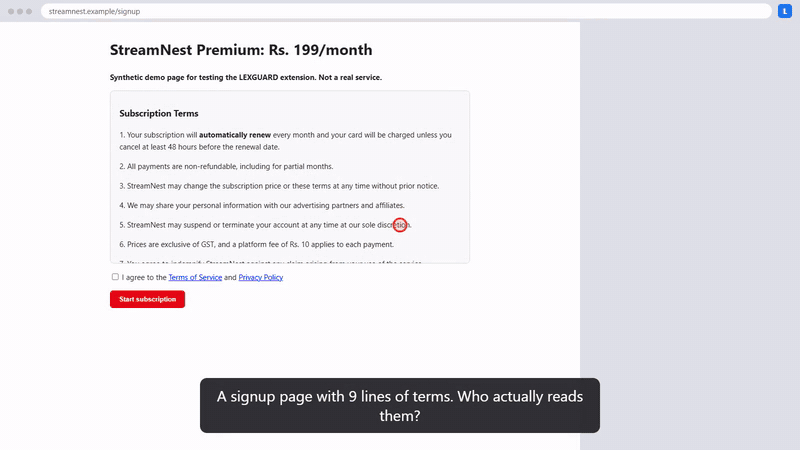

# LEXGUARD

[](https://github.com/lakshmang007/LexGuard/actions/workflows/test.yml)

**See the risky sentence before you sign.** LEXGUARD is a Chrome extension (plus an optional local web app) that checks offer letters, quotations, ticket terms and online policies sentence by sentence. It shows you which sentences put **you** at risk, explains each in plain words, and tells you what to ask before you sign.

It runs entirely in your browser. There is no server to set up, no account, no AI model and no upload.

*Team Root Coders (Shiva Kumar, Lavanya, Madhu S, Lakshman G) · HACKNOVA-26 (ANVESHANA-26)*

> A review aid, not legal advice. All sample documents in this repo are synthetic: no real people or contracts.

[](demo/LEXGUARD_Demo_Video.mp4)

**Videos:** [77-second demo](demo/LEXGUARD_Demo_Video.mp4) (page check, score, chat, offer letters, a Hindi document) · [60-second install guide](demo/LEXGUARD_Install_Video.mp4)

## Features

- **Highlights risks on the real page:** red for serious, yellow for medium, directly in a site's terms. Click a risk to jump to its sentence.
- **Plain-words report:** a 0–100 score you can trace point by point, "What is this?" (what the document is, who it's with, reading time, topics), the main risks, and the questions to ask.
- **Only risks that fall on you:** the Defender lowers a risk when the document also protects you, and removes sentences that are your own choice or a promise to you. The removed sentences are still listed under **Not a risk for you**.
- **Ask LEXGUARD:** an offline chat that answers "Should I sign this?", "Can I get a refund?", "Explain clause 7" or "What is indemnity?" from the report, the rules and a glossary. Every answer quotes the sentence and links to it.
- **Indian rules:** service bonds, long notice periods, withheld salary or certificates, and non-competes, with notes on the Indian Contract Act and the Consumer Protection Act.
- **PDF and text upload,** read offline with Mozilla pdf.js; a ready-to-send clarification email; save the report as PDF; light and dark mode.

## Installation

**Requirements:** Chrome, Edge or Brave **116 or newer** on desktop. The extension has no other dependencies.

LEXGUARD is not on the Chrome Web Store yet, so it is installed in Developer mode. The [install video](demo/LEXGUARD_Install_Video.mp4) (60 seconds, recorded in Microsoft Edge; Chrome is the same) shows every step:

1. Download **`LEXGUARD-0.7.0.zip`** from the [latest release](https://github.com/lakshmang007/LexGuard/releases/latest) and unzip it. (Or download this repository with **Code → Download ZIP** and use its `extension` folder.)
2. Open `chrome://extensions` (or `edge://extensions`) and turn on **Developer mode**.
3. Click **Load unpacked** and choose the unzipped **`LEXGUARD`** folder (the one that contains `manifest.json`). Choosing a folder above it gives "Manifest file is missing".
4. Pin LEXGUARD from the puzzle-piece menu.
5. To check local `.html` files (like the demo signup page), open the extension's **Details** and turn on **Allow access to file URLs**.

## Quick start

1. Open any signup or terms page, or `demo/5_StreamNest_Signup_Page.html`.
2. Click the LEXGUARD icon, then **Check this page**. The first time, Chrome asks for access: choose **Allow**.
3. Read the verdict, open **How was this score worked out?**, then ask a question in **Ask LEXGUARD**.

For the demo page you should see **76/100, high risk**, with eight sentences highlighted.

## Usage

| What you want | How |
|---|---|
| Check the page you're on | Side panel → **Check this page** |
| Check only part of a page | Select the text → right-click → **Check selected text with LEXGUARD** |
| Check a PDF or pasted text | Side panel → **Paste or upload a document (.txt / .pdf)** → upload, paste, or try a sample |
| See where a score comes from | **How was this score worked out?** under the score |
| Ask about the document | **Ask LEXGUARD** box, or click a suggested question |
| Send questions to the other side | **Copy clarification email** |
| Save the report | **Save report as PDF** (checker page) |

**Limits:**
- Chrome's built-in PDF viewer can't be read by extensions, so upload PDFs in the checker instead.
- Scanned PDFs without a text layer need OCR, which isn't built yet.
- Only **English** documents are checked. When most of a document's letters are not Latin (Hindi, Kannada, Tamil, Chinese and so on), LEXGUARD shows an "English documents only" notice instead of a score, so it never calls such a document safe. Very short non-English snippets (under 20 letters) are still checked as if they were English.
- Rule-based detection catches about 74% of unfair website terms and 59% of business-contract risks, so a clean report does not mean a document is safe.

## How it works

LEXGUARD is a **rule-based** pipeline of four agents. The same pipeline exists in Python (`engine/`) and in the browser (`extension/engine.js`), and a parity test keeps them identical.

```
page text / selection / PDF / pasted text
   │
1. Extractor    sentences and clauses, with exact positions (so they can be highlighted)
2. Risk Finder  32 risk rules from engine/rules/rules.json (4 are Indian-law rules)
3. Defender     (a) finds protections elsewhere in the document → lowers the risk
                (b) checks who each sentence affects → drops your rights and promises to you
4. Judge        LOW / MEDIUM / HIGH per sentence; score = points per kind of risk
   │
report · highlights · Ask LEXGUARD · clarification email
```

**Score:** each kind of risk counts once, at its worst level. HIGH +15, MEDIUM +5, LOW +1, capped at 100. A score of 50 or more is HIGH risk, 20–49 is MEDIUM, and under 20 is LOW.

More detail:
- [docs/ARCHITECTURE.md](docs/ARCHITECTURE.md): components, data flow, the "who does it affect?" check, and the score.
- [docs/RULES.md](docs/RULES.md): all 32 risks and 18 protections.

## Local web app (optional)

A local copy of the checker that runs on the Python engine. You need it only for development or the evaluations.

**Requirements:** Python 3.9+ (standard library only). `pypdf` is optional and needed only for PDF upload in the web app:

```bash
pip install -r requirements.txt   # optional: pypdf>=6.0, for PDF upload
python server.py
```

Open http://127.0.0.1:8787. The demo signup page is at http://127.0.0.1:8787/web/demo_signup.html.

### Configuration

| Setting | Default | What it does |
|---|---|---|
| First command-line argument, e.g. `python server.py 9000` | `8787` | Port |
| `PORT` environment variable | `8787` | Port, if no argument is given |
| `LEXGUARD_AI_ENDPOINT` environment variable | unset | Placeholder for a future optional AI layer. `engine/ai_layer.py` is a stub: setting this changes nothing today |

The server is meant for local development only:
- It listens on `127.0.0.1` and answers only requests addressed to `127.0.0.1:<port>` or `localhost:<port>` (others get 403), and it sends no CORS headers, so other websites can't read from it.
- Each route serves files only from its own folder (`web/`, `extension/`, `samples/`).
- Request bodies over 10 MB get 413; bad input gets 400 with a short message, and error details go to the terminal only.

See the [security audit](docs/audits/security-audit-2026-11-19.md) before exposing it anywhere.

## Testing

One command runs everything (needs Node.js 18+ for two of the steps; they are skipped without it):

```bash
python tools/run_all_tests.py
```

It syncs the extension copies, checks they match their sources, then runs:

| Step | Command | What it checks |
|---|---|---|
| Benchmark | `python -m eval.benchmark` | synthetic samples vs 6 targets, including refusing non-English documents |
| Parity | `python -m eval.parity_check` | Python engine == browser engine on 2,895 documents and sentences |
| Chat | `node eval/chat_test.js` | 65 chatbot tests: intents, escaping, planted markup, non-English reports |
| Server | `python -m eval.server_test` | 18 checks on the local server: path tricks, Host check, size limits, errors |

GitHub Actions runs it on Ubuntu and Windows with Python 3.9 and 3.13 on every push and pull request ([`.github/workflows/test.yml`](.github/workflows/test.yml)).

The accuracy numbers below come from a separate, slower command:

```bash
python -m eval.public_datasets --split test   # UNFAIR-ToS + CUAD held-out results; rewrites eval/results_public.*
```

### Results

| Test | Result |
|---|---|
| Synthetic samples (29 planted risks) | 100% caught, 0% clean clauses marked HIGH |
| **UNFAIR-ToS** (1,607 held-out sentences from 50 websites) | **74.4%** of unfair sentences caught, 56.4% precision, 3.0% of fair sentences marked HIGH |
| **CUAD** (255 held-out contracts, 941 clauses, 7 categories) | **59%** caught (from 21%) |
| Real terms pages | GitHub 84, Flipkart 68, Zomato 65, Razorpay 59, Netflix 56, Spotify 45 |

The rules were tuned only on the training data, and the reported numbers come from data they were never tuned on. Full tables are in [`eval/results_public.md`](eval/results_public.md); dataset sources and licences are in [`datasets/README.md`](datasets/README.md).

## Project layout

```
extension/   Chrome extension: engine.js, chat.js, side panel, content script, checker page, pdf.js
engine/      Python engine: extractor, risk_finder, defender, impact, judge, doc_type, rules/rules.json
web/         local web app pages; report.js, chat.js, style.css, theme.js, motion.js (copied into extension/)
server.py    local web app server (standard library)
samples/     synthetic test documents and planted-risk labels
demo/        demo kit: sample .txt/.pdf files, demo signup page, HOW_TO_DEMO.txt, demo and install videos
datasets/    UNFAIR-ToS and CUAD (CC BY 4.0)
eval/        benchmark, dataset evaluation, parity check, chat and server tests, results
tools/       run_all_tests.py, make_release.py, sync_extension.py, make_demo_kit.py, make_rules_doc.py
docs/        architecture, rule reference, audit reports
```

## Documentation

- [Architecture](docs/ARCHITECTURE.md)
- [Rule reference](docs/RULES.md)
- [Demo guide](demo/HOW_TO_DEMO.txt)
- Audits: [re-audit for 0.7.0 (2026-11-23)](docs/audits/release-audit-2026-11-23.md); first round (2026-11-19): [security](docs/audits/security-audit-2026-11-19.md) · [release readiness](docs/audits/release-audit-2026-11-19.md) · [compatibility](docs/audits/compatibility-audit-2026-11-19.md)
- [Changelog](CHANGELOG.md)

## Contributing

See [CONTRIBUTING.md](CONTRIBUTING.md). Before opening a pull request, run `python tools/run_all_tests.py`.

## AI disclosure

The app itself uses **no AI model or AI service**. Claude (Anthropic) helped plan the project and write its code, rules, synthetic samples and documentation; the team reviews, tests and extends it.

## Licence

[MIT](LICENSE) © 2026 Team Root Coders. Third-party parts keep their own licences:
- `extension/vendor/pdf.min.js` and `pdf.worker.min.js`: Mozilla pdf.js 3.11.174, Apache License 2.0 ([`extension/vendor/LICENSE-pdfjs.txt`](extension/vendor/LICENSE-pdfjs.txt)).
- `datasets/`: CC BY 4.0, with attribution in [`datasets/README.md`](datasets/README.md).
